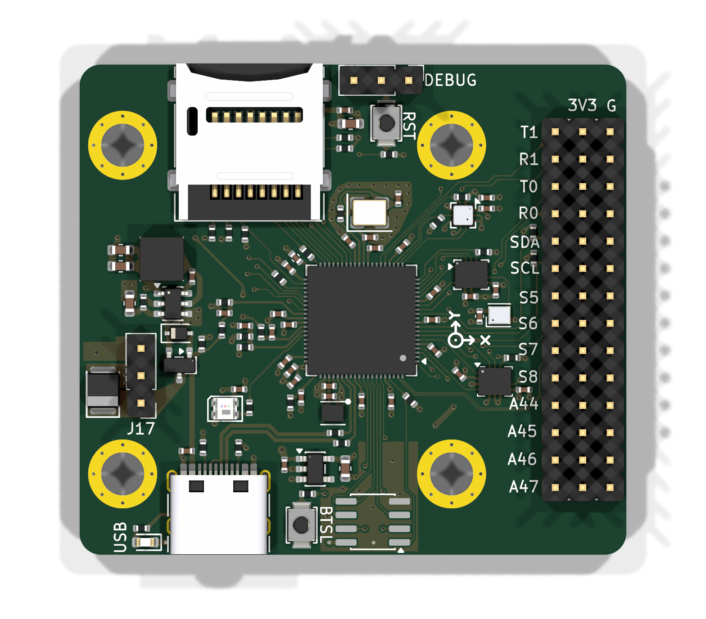
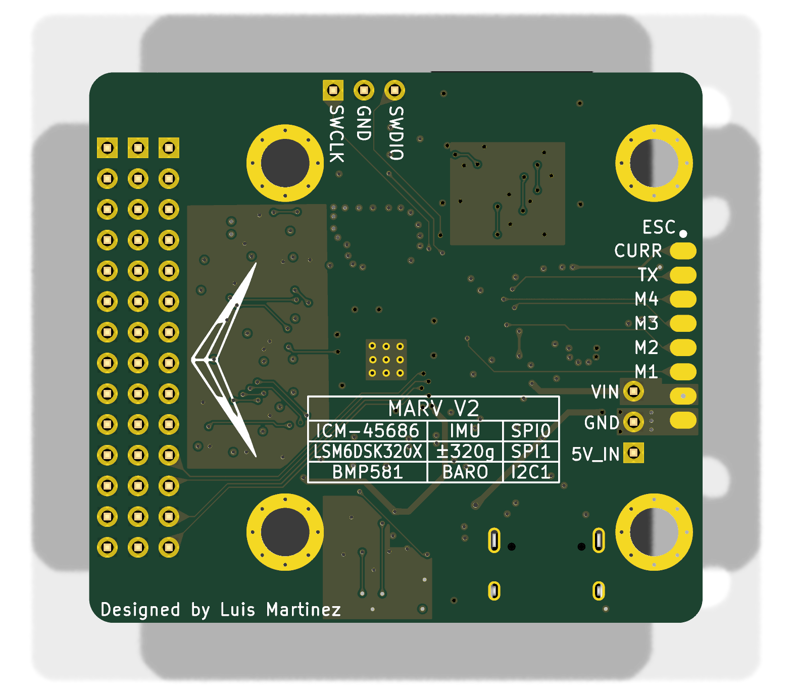

# MARV V2 flight controller

A small RP2354B flight controller for rockets and drones: a 6-axis IMU, a high-g
accelerometer and a barometer on their own buses, native four-bit microSD
logging, USB-C, and an IO block for GPS, ELRS, a magnetometer and servos. Power
conversion uses a purchased module that plugs onto the board at J17, so the
converter and FC mount as one unit; the FC takes its regulated 5 V (or USB) and
makes its own 3.3 V rails.

**License:** hardware/docs CC0, code 0BSD, no attribution required. Provided
as-is; see [LICENSE.md](LICENSE.md).

Open [MARV-V2.kicad_pro](MARV-V2.kicad_pro) in **KiCad 10**. The repository holds
the schematic and routed board, local footprints and 3D models, a datasheet
source index, the design checks, and the input-power simulation. There
is no firmware here.

**Status, Rev 1 (2026-10-27): routed; manufacturing frame and `production/` package regenerated
from this revision.** Source DRC: 206 violations (22 accepted errors, 184 warnings), 0 unconnected,
0 schematic-parity issues. The accepted errors are 18 GND-via hole clearances in the RP2350 (U20)
exposed pad (JLC hole-in-pad rule), 3 USB pair clearances at the connector and MCU pins, and 1 SW1/J10
courtyard overlap. ERC: 0 violations. The [72 × 72 mm manufacturing frame](reports/manufacturing-panel.md)
supplies rails/fiducials for Standard assembly. Review JLCPCB previews before ordering. Before
ordering, also confirm with HCI that the X1 1521H-32K000J18DTSL "J18" build is rated for 3.3 V
(see [datasheets/README.md](datasheets/README.md)).

**Converter and ESC pads:** J17 is a 1x03, 2.54 mm converter interface
(1 OUT+, 2 GND, 3 IN+) with no EN contact. J3 is an eight-pad ESC pad row; pad 7 is raw
battery VIN. See [converter review](reports/converter-module-review.md).

[Design specification](DESIGN_SPEC.md) · [GPIO pinout](PINOUT.md) ·
[Libraries](LIBRARIES.md) · [Datasheets](datasheets/README.md) ·
[JLCPCB DFM and routing](reports/jlc-dfm-routing.md) · [Working rules](AGENTS.md)

**See the results without running anything:** the [results website](https://lmx154.github.io/MARV-V2-PCB/)
shows the ngspice power-input waveforms, the netlist and footprint checks, and the
DRC/ERC summary for the current revision. Refresh it with `python3 tools/build_site.py`
(writes `site/`; pushing `site/` to master republishes it via GitHub Pages).

## Repository map

```text
MARV-V2.kicad_pro / _pcb / _sch    project, routed board, root schematic
*.kicad_sch                        11 sub-sheets: power OR / 3V3 / VBAT, MCU, IMU, high-g, baro, SD, USB & debug, IO block, QSPI expansion
MARV-V2.kicad_dru, MARV_Sensors.kicad_sym, *-lib-table    custom rules, project symbols, library tables
MARV-V2-panel.kicad_*              one-board manufacturing frame for Standard assembly with customer-supplied rails
fabrication-toolkit-options.json   native Fabrication Toolkit settings for JLCPCB order exports
DESIGN_SPEC.md, PINOUT.md          intended circuit, boundaries and design decisions; every GPIO with its alternates
LIBRARIES.md, AGENTS.md            footprint/model provenance; working rules
MARV_Packages.pretty/, .3dshapes/  local footprints and STEP models
datasheets/                        datasheet source index (PDFs are downloaded locally, not distributed)
tools/                             netlist checker, footprint audit, input-power simulation, PCB renderer, 3d/ (STEP inspection)
tools/panel/                       manufacturing-frame sync and checks; README has the refresh sequence
simulations/                       input-power SPICE deck, README and generated results
reports/                           decision and review records (table below)
orders/rev1/                       Rev 1 JLCPCB order record: exact upload files, all order options, BOM as ordered
images/                            PCB renders used in this README
site/                              results website (simulation, checks), built by tools/build_site.py
.github/workflows/pages.yml        publishes site/ with GitHub Pages
LICENSE.md, LICENSES/              project licence and upstream library notices
production/, build/                generated output; untracked
```

## The board

| Front | Back |
| :---: | :---: |
| [](images/pcb/marv-v2-front.png) | [](images/pcb/marv-v2-back.png) |

3D renders of the saved PCB (regenerated 2026-10-27 with the project's own CC0 models for
J4, J11, C19, X1, D20, U20 and the three sensors). J17 is the three-pin header on the front's left edge. Click
either image for the full-resolution view.

To refresh both images after saving PCB changes, run:

```sh
python3 tools/render_pcb.py
```

Requires Python 3 and KiCad 10 with its 3D model libraries. The script renders
high-resolution PNGs into `images/pcb/` without modifying the design. Update the
images after PCB changes to keep this gallery current.

| | |
|---|---|
| MCU | RP2354B (QFN-80, 2 MB in-package flash), 12 MHz crystal, USB-C device port, WS2812C status LED, RESET and BOOTSEL buttons, SWD header |
| Size / stack | 50.7 × 45.5 mm finished outline (72 × 72 mm manufacturing frame), four layers: F.Cu signals · In1 solid GND · In2 V3V3_SYS plane · B.Cu signals. 1.6 mm FR-4, 1 oz outer / 0.5 oz inner, green mask, ENIG |
| Rules | 0.15 mm minimum track and clearance (Signal netclass 0.10 / 0.10 mm), through vias only (0.60 / 0.30 mm; Signal class 0.45 / 0.30 mm), no blind/buried/micro vias — JLCPCB's standard four-layer tier with no paid options |
| Assembly | Front side SMT at JLCPCB (90 placements, 34 unique LCSC parts). Hand-fitted / unpopulated: ESC pad row J3 (back), SWD header J10 (front), DNP QSPI expansion U24 (front). J17 converter header is hand-fitted and excluded from the position file |
| Mounting | Four M3 grommet holes (4.0 mm) with GND rings, on a 30.5 × 30.5 mm square pattern. The 5 V converter module mounts on the FC itself at J17 |
| Connectors | J3 ESC pads (current, telemetry, PWM1–4, raw battery VIN, GND), J4 USB-C, J6/J7/J8 IO block (14 rows × signal / power / GND), J10 SWD, J11 locking microSD; J17 1x03 2.54 mm converter mount (1 OUT+ / 5V_IN, 2 GND, 3 IN+ / VBAT) |

## Sensor suite

Every sensor has its own bus; no clock or data net is shared between devices, so
each can be driven at its own rate and no transaction blocks another.

| Ref | Part | What it measures | Bus | Interrupts |
|---|---|---|---|---|
| U21 | InvenSense ICM-45686 | 6-axis IMU (gyro + accel), primary attitude source | hardware **SPI0**, exclusive; 32.000 kHz HCI 1521H oscillator X1 on CLKIN (pin 9) | INT1 only |
| U23 | ST LSM6DSK320X | secondary 6-axis IMU with a ±320 g high-g channel for launch / impact / hard landings | hardware **SPI1**, exclusive | INT1, INT2 |
| U22 | Bosch BMP581 | barometric altitude and temperature | hardware **I2C1**, address 0x46 | INT |
| J11 | Molex 47219-2001 microSD | flight log | PIO + DMA, native **four-bit SD** | — |

The three sensors run from the dedicated V3V3_ANA rail with their chip-select
and I²C pull-ups referenced to it, and all four interrupt lines land on
independent GPIOs. Layout follows the makers' notes: the BMP581 has no copper or
solder mask under its body (Bosch §8.2), and the inertial sensors sit close to
the MCU with short SPI runs. Exact GPIO numbers are in [PINOUT.md](PINOUT.md).

## Power architecture

```text
ESC V (raw battery) → J3.7 / VBAT → J17.3 VIN → converter → J17.1 VOUT
                                      ↓ 5V_IN               USB-C VBUS
                                      Q1 (AO3401A)           D1 (1N5819WS)
                                      └────────── V5_SYS ────┘
                                                    ├─ AP63203 buck → V3V3_SYS  (MCU, microSD, IO block, LDO enable)
                                                    ├─ TPS7A2033 LDO → V3V3_ANA (ICM-45686, LSM6DSK320X, BMP581, ADC_AVDD)
                                                    └─ status LED
RP2354B on-chip switcher: V3V3_SYS → 1.1 V core (laid out per RP2350 datasheet §6.3.8)
Converter VIN / J17.3 (VBAT) → 100k / 10k divider → ADC (parallel sensing branch)
```

Nothing that moves is powered through the FC. Motors, servos and ESCs get only
their signal pins. Raw pack voltage supplies the J17 converter and voltage divider.
The full boundary table is in [DESIGN_SPEC.md](DESIGN_SPEC.md#sources-and-loads).

**External 5 V converter on J17.** The converter is a purchased module that
plugs straight onto the FC through J17, a 1x03 2.54 mm vertical pin header:
pin 1 OUT+ (`5V_IN`), pin 2 GND, pin 3 IN+ (`VBAT`, raw battery from ESC V via
J3.7); the module's EN contact is not connected. Because the converter rides on
the board, the stack mounts as one unit, which keeps mounting simple. Its
output enters upstream of Q1/D1, never directly at V5_SYS. Set and verify the 5 V
output before fitting the module. Its body outline and clearance (including
microSD lid access) are not yet verified: the J17 footprint covers the pins only.
See the [converter review](reports/converter-module-review.md).

Battery current comes from the GOKU G55M ESC's analog C output on J3.1 (R53/C78 →
GPIO41/ADC1); VBAT is sensed by R27/R28/C48 on GPIO42/ADC2. The G55M's output
scale and offset still need calibration. See [G55M sensing](reports/g55m-battery-sensing.md).

## Design decisions

The reasons behind each major choice are recorded in [DESIGN_SPEC.md](DESIGN_SPEC.md#design-decisions).

## Validating the power input with simulation

The one thing the board cannot control is how power arrives, so that is the one
thing simulated. `tools/simulate_power_input.py` builds an ngspice deck from the
**saved schematic** (it checks the Q1/D1/C19 wiring before running) and drives
V5_SYS through seven cases: external 5 V only; USB only; both present; USB
plugged in while external stays; USB unplugged; external unplugged; and an
external-only load step. The pass criterion is explicit: the lowest V5_SYS seen
in any event window must stay above the AP63203's 3.8 V input minimum, or the
script exits 1.

```sh
python3 tools/simulate_power_input.py                       # default 0.5 A at V5_SYS
python3 tools/simulate_power_input.py --load 0.3 --usb-voltage 4.75
python3 tools/simulate_power_input.py --load 0.5 --external-load 1.0
```

Latest result ([simulations/RESULTS.md](simulations/RESULTS.md)): lowest event
voltage **4.269 V** during USB removal, margin 0.47 V over the floor; USB-only
operation settles at 4.32 V through D1. Assumptions are stated, not hidden:
0.05 Ω external source, 0.35 Ω USB source, a 0.5 A combined demand that is a
starting point rather than a measured budget, the vendor AO3401A model and a
hand-fitted 1N5819WS curve. It does **not** simulate the downstream regulators,
USB negotiation, sensor noise, layout parasitics or temperature — see
[simulations/README.md](simulations/README.md) for the boundary. Anything
beyond the OR is validated on hardware, not in SPICE.

## Verifying the design

Requirements: Python 3, KiCad 10 with its standard libraries, ngspice. Ordering exports use the installed Fabrication Toolkit plugin.

```sh
mkdir -p build/checks
kicad-cli sch erc --severity-all --exit-code-violations -o build/checks/erc.rpt MARV-V2.kicad_sch
kicad-cli sch export netlist --format kicadxml -o build/checks/netlist.xml MARV-V2.kicad_sch
python3 tools/check_power_netlist.py build/checks/netlist.xml   # rails, all 48 GPIOs, bus endpoints, pull-ups, absent refs
python3 tools/audit_footprints.py build/checks/netlist.xml     # footprint/model availability and pin coverage
kicad-cli pcb drc --schematic-parity --severity-error --severity-warning --format json -o build/checks/drc.json MARV-V2.kicad_pcb
```

Design rules live in `MARV-V2.kicad_pro` (board setup) and `MARV-V2.kicad_dru`
(JLCPCB custom rules); edit them in KiCad. Netclasses: Signal 0.10 mm / 0.10 mm clearance
(vias 0.45 / 0.30 mm); Default, Rail3V3 and CoreDVDD 0.20 mm; Analog3V3 0.30 mm; Power 0.50 mm
(vias 0.80 / 0.40 mm); USB 0.36 mm / 0.18 mm clearance; other vias 0.60 / 0.30 mm. Teardrops are on all vias
and pads except the LGA sensors U21, U22 and U23.

## Ordering

**Rev 1 was ordered from JLCPCB. The exact upload files and every PCB and PCBA option
selected are archived in [orders/rev1/](orders/rev1/README.md). To reorder Rev 1, follow
that record; it takes precedence over the general steps below.**

Use the installed [Fabrication Toolkit](https://github.com/bennymeg/Fabrication-Toolkit)
from KiCad's PCB Editor. Project settings are saved in
[fabrication-toolkit-options.json](fabrication-toolkit-options.json); no custom
Gerber, BOM or placement exporter is needed.

1. Open **MARV-V2-panel.kicad_pro** for the Standard assembly export. This is
   a saved manufacturing copy with customer-supplied rails. After circuit-design
   changes, update the original board, synchronize the manufacturing copy, and
   run the checks before exporting. See the [panel notes](reports/manufacturing-panel.md).
2. Click **Fabrication Toolkit → Generate**. The saved options enable automatic
   component translations and exclude DNP parts. The **User.1 V-cut option is on** for the manufacturing panel. Automatic zone
   refill, alternate outlines and plotting all active layers are **off**. Refill zones
   yourself in KiCad when copper changes require it, before the final DRC.
3. Upload the generated files:

   | JLCPCB step | File |
   | --- | --- |
   | PCB fabrication | `production/MARV-V2-panel.zip` (Gerbers and drills with rails) |
   | Assembly parts | `production/bom.csv` |
   | Assembly placement | `production/positions.csv` |

These three files were regenerated together from the manufacturing panel on
**2026-10-27**. The BOM and placements match the final-routed board; the Gerbers
include the rails, routed channels, V-score annotations and fiducials;
the NPTH drills include tooling holes and the original USB locating holes. The local
`production/order-manifest.json` records source/output SHA-256 hashes, and
`production/SHA256SUMS` checks the three upload files. See the
[panel verification](reports/manufacturing-panel.md) for validation results
and remaining preview checks. Regenerate after any saved design change.

The initial order is **5 PCBs manufactured, 2 assembled on the top side** and
3 bare. Select **1 design, Delivery Format: Panel by Customer (1 × 1), 4 layers, 1.6 mm, green mask, white silk,
ENIG, standard copper and 0.30 mm minimum via holes**. Use
**Standard assembly** and **Edge Rails/Fiducials → Added by Customer**.
The 72 × 72 mm frame contains one finished PCB and uses two full-height
V-scores through its side connections, with no mouse-bite holes or added rail silk. It can be removed after delivery; check the quote no longer includes
JLC's rail-addition service charge.

The schematic's `LCSC` fields and native BOM/position exclusions define the
assembly selection. J6–J8 and J10 are owner-soldered headers; J3, H1–H4
and the graphic footprints are board features; U24 is DNP. All are
omitted from assembly exports. This leaves **90 front-side placements using
34 distinct LCSC parts**. The plugin generates one BOM row per component value
and note; `tools/panel/merge_bom.py` merges them to 35 lines (34 LCSC parts plus
the J17 line without an LCSC number). JLC's parts-selection page provides current
stock and pricing.

Automatic translations apply the plugin's package rotation corrections; they
are export corrections, not changes to the PCB layout. Review every placement
in JLC's preview, especially the custom sensor footprints and **L20: orientation
dot toward pad 2 / DVDD**. `tools/panel/check_positions.py` checks the 2026-10-27 export against the
source board: all 90 placements match in part and position.

`production/` is generated and ignored by Git; use the three plugin files above
together. [tools/panel/README.md](tools/panel/README.md) has the exact refresh sequence.

## Reports

Decision and review records, newest first:

| Report | What it records |
|---|---|
| [converter-module-review.md](reports/converter-module-review.md) | The J17 on-board 5 V converter mount, its three-pin interface, battery compatibility and open fit questions |
| [g55m-battery-sensing.md](reports/g55m-battery-sensing.md) | G55M ESC current and battery sensing connections and limits |
| [manufacturing-panel.md](reports/manufacturing-panel.md) | Customer-supplied V-cut frame, current order package and panel verification |
| [usb-differential-routing.md](reports/usb-differential-routing.md) | The 0.36 mm / 0.20 mm gap USB differential-pair preset and the manufacturer guidance behind it |
| [jlc-dfm-routing.md](reports/jlc-dfm-routing.md) | JLC capability sources behind every installed constraint |
| [sd-connector-replacement.md](reports/sd-connector-replacement.md) | The locking microSD socket (J11): choice, pinout and footprint |

Placement and routing are done by hand in KiCad and are never regenerated — see
[AGENTS.md](AGENTS.md).
