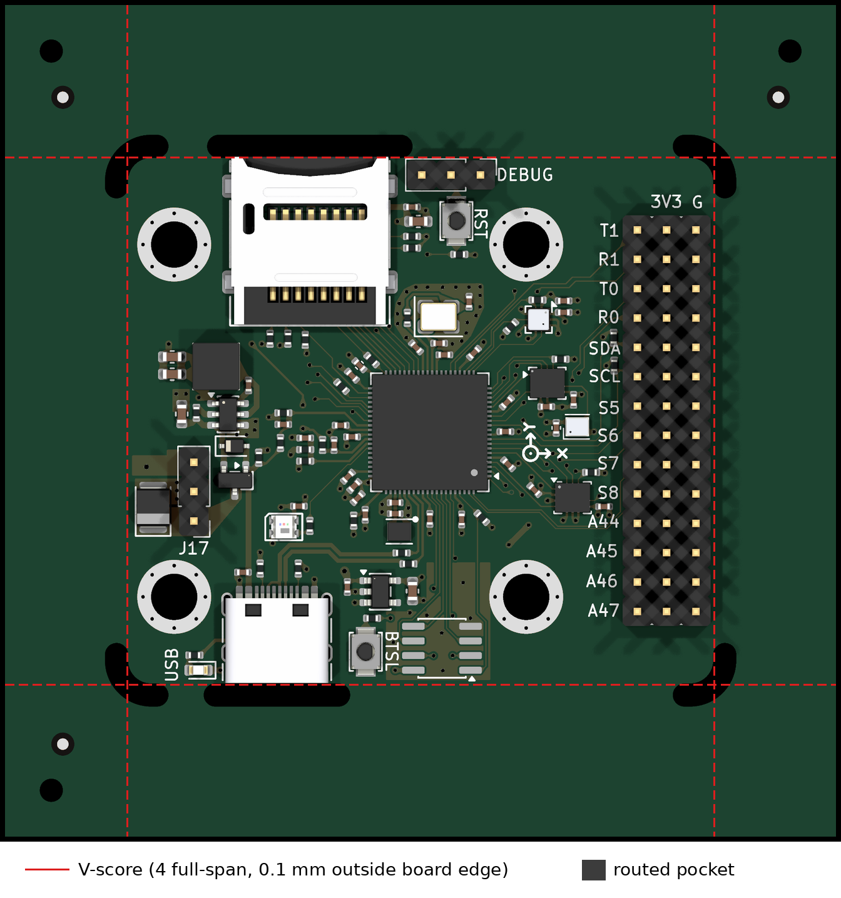

# Customer-supplied V-cut frame — Rev 1

The saved [MARV-V2-panel.kicad_pcb](../MARV-V2-panel.kicad_pcb) is a
**72 × 72 mm, one-board manufacturing frame** for Standard assembly. The board
is held by **four full-span V-scores, one along each straight edge**. Only the
rounded corners and the USB-C/microSD overhangs are routed. There are no side
slots, no mouse-bite holes, and no added panel silkscreen. The frame leaves the MARV-V2
circuit board and schematic unchanged.

KiCad's 3D render does not model V-score grooves. See the
mechanical cut drawing for their locations.
The four `V-CUT` labels are fabrication annotations, not printed silkscreen.

## Upload this package

| JLCPCB step | File |
| --- | --- |
| PCB fabrication | `production/MARV-V2-panel.zip` |
| Assembly parts | `production/bom.csv` |
| Assembly placement | `production/positions.csv` |

The `production/` directory is generated locally and is not tracked; the refresh
sequence in [tools/panel/README.md](../tools/panel/README.md) writes these files
together with `SHA256SUMS` and `order-manifest.json` (regenerated 2026-10-27).

Select **Standard**, **Top Side**, **Edge Rails/Fiducials: Added by Customer**.
The panel contains one circuit design and one finished board. Keep the intended
quantity of 5 boards/frames manufactured, 2 assembled. BOM and position CSVs
are generated from the panel (same origin: panel centre, Y up). `bom.csv` has 35
lines (34 distinct LCSC parts plus the J17 line without an LCSC number, 91 parts).
Tooling holes and fiducials are excluded from both assembly CSVs.

Assembly selection follows the source: H1–H4, J3, J6–J8 and J10 are
excluded from the BOM and position files (J6–J8 are hand-soldered by the owner).
J17 (5 V converter module) is in `bom.csv` with no LCSC number and is excluded
from `positions.csv`. `positions.csv` has 90 top-side parts and nothing on the
bottom side.

Confirm JLC's CAM preview shows four straight V-scores and the routed corner
and connector pockets. The ZIP does not include the drill-map drawings
(reference only), whose overlapping legends clutter JLC's viewer.

## Mechanical details

- Frame: 72 × 72 mm, centered at (100, 100) mm (JLC's V-cut / Standard
  assembly minimum is 70 × 70 mm).
- Source board body: 50.7 × 45.5 mm between Edge.Cuts centerlines.
- V-score centerlines: **x = 74.55 and 125.45 mm, y = 77.15 and 122.85 mm**,
  each spanning the full panel. Each is **0.10 mm outside** the source edge,
  so the finished board is 50.9 × 45.7 mm with a 0.10 mm lip on each side.
- The offset exists because the inner-plane pours stop 0.30 mm from the board
  edge; 0.10 mm puts the scores at JLC's 0.40 mm copper clearance without
  touching the copper.
- Routed pockets (2 mm cutter): one at each R2 corner, one under the microSD
  overhang (top) and one under the USB-C overhang (bottom, x 81.205–93.895 mm for J4 at (87.55, 119.06)). No other routing
  touches the board.
- Three 2 mm NPTH tooling holes are present. Three top-side fiducials sit at
  (69, 72), (131, 72) and (69, 128) mm, clear of all score lines.
- `User.1` contains only the four score lines and four `V-CUT` labels.
  Fabrication Toolkit merges this layer into the outline Gerber using its
  V-cut option.

Depanel by bending each rail along its score **away from the components**
(top and bottom rails especially, where the connectors overhang the pockets).

## Verification

- Copper-to-score clearance, all four copper layers (tracks, vias, pads, copper
  graphics, filled zones), bounding-box method: minimum **0.4005 mm** (GND and
  V3V3_SYS inner-plane pours, all four scores) against JLC's 0.40 mm. Nearest
  non-pour copper is 0.60 mm (J3 pads, left score).
- Panel DRC, using `MARV-V2-panel.kicad_pro`/`.kicad_dru` copied from the
  source: 0 unconnected items and exactly the source's 206 violations (3 clearance,
  1 courtyards_overlap SW1/J10, 18 hole_clearance, 184 warnings), with nothing
  added or removed and no schematic-parity issues in the source.
- Source file unchanged during the sync (SHA-256 in the manifest). The panel
  keeps every source item verbatim except the four straight Edge.Cuts segments:
  104 source footprints identical in position, rotation and side, 867 tracks,
  200 vias and 535 zones identical. No zones were modified or refilled.
- The USB-C pocket is derived from J4's courtyard (x 82.205–92.895) plus
  1.0 mm each side (pocket x 81.205–93.895 mm). J4's courtyard overhangs the
  board edge by 0.485 mm.
- Source ERC: 0 violations.
- The exported outline Gerber contains all four full-span score lines
  (x = ±25.45 mm and y = ±22.85 mm from the panel centre).

Evidence: the 2026-10-27 sync was produced with the scripts in
[tools/panel/](../tools/panel/README.md) (generator, verification scripts); their
outputs go to `build/panel/`. Review JLC's assembly preview,
particularly sensor rotations and L20 polarity.

## Future exports

Open **MARV-V2-panel.kicad_pro**. Use the installed Fabrication Toolkit with
**User.1 V-cuts enabled**, automatic component translations and DNP exclusion
on, and automatic zone refill off. These options are saved in
`fabrication-toolkit-options.json`. V-cut export must remain enabled so the
score lines reach the fabrication files; annotations are not on silkscreen.
The toolkit always adds `*-drl_map.gbr` drawings. Remove them from the ZIP
before uploading.

The panel is a saved manufacturing copy, not a live link. After a circuit-board
edit, synchronize the copy, recheck copper-to-score clearance and DRC, then
regenerate the package before ordering; the exact sequence is in
[tools/panel/README.md](../tools/panel/README.md). Do not export the unpanelized source
board when selecting customer-supplied rails.
